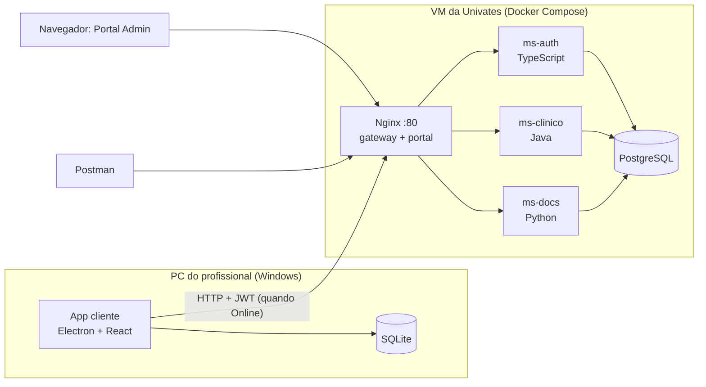

# MedicalField

[](https://github.com/CezarGarcia/Offline-First-Medical-Record/actions/workflows/testes.yml) [](https://github.com/CezarGarcia/Offline-First-Medical-Record/actions/workflows/instalador-windows.yml)

**Prontuário Médico de Emergência com arquitetura offline-first.** Trabalho final da disciplina 4815206 – Arquiteturas de Software (Univates, 2026/B).

Equipes de resgate (SAMU, ambulâncias de rodovia, equipes em desastres) muitas vezes atendem sem internet. No MedicalField, o profissional registra o paciente, o prontuário e a ficha de atendimento num **app que funciona sem conexão**. Quando a conexão volta, os dados são sincronizados com um **backend de microsserviços em três linguagens**, **sem duplicar**, **sem perder a origem** de cada registro e **resolvendo conflitos**. Os registros podem ser consultados num **portal administrativo**, exportados em **PDF** e enviados por **e-mail**.



## Componentes

| Componente | Pasta | Linguagem / tecnologia | O que faz |
|---|---|---|---|
| App cliente | [`apps/cliente`](apps/cliente) | Electron, React, TypeScript, Mantine, SQLite | Uso em campo, online e offline, com a chave "Simular Conectividade": ficha de atendimento, fila de sincronização, login offline, PDF e e-mail |
| Portal Admin | [`apps/portal`](apps/portal) | React, TypeScript, BoardUI (Tailwind + React Aria) | Consulta de atendimentos, prontuários, cadastros, logs e conflitos; PDF e e-mail da ficha. Servido pelo Nginx |
| Código compartilhado | [`apps/compartilhado`](apps/compartilhado) | TypeScript | Tipos da API, rótulos e formatação usados pelo portal e pelo app cliente |
| ms-auth | [`servicos/ms-auth`](servicos/ms-auth) | TypeScript (Node.js) | Login, sessão, tokens, profissionais e auditoria |
| ms-clinico | [`servicos/ms-clinico`](servicos/ms-clinico) | Java (Spring Boot) | Pessoas, prontuários, atendimentos, medicamentos e sincronização |
| ms-docs | [`servicos/ms-docs`](servicos/ms-docs) | Python (FastAPI) | PDF da ficha de atendimento e envio por e-mail |
| Infraestrutura | [`infra`](infra) | Docker Compose, Nginx, PostgreSQL | Tudo que roda na VM |
| Coleção do Postman | [`postman`](postman) | Postman / Newman | Todas as rotas, com login automático e testes; a pasta 1 é o roteiro do Postman da apresentação |
| Integração contínua | [`.github/workflows`](.github/workflows) | GitHub Actions | A cada push: os testes de cada parte, o sistema inteiro no Docker e o instalador do Windows |

## Documentação

Comece por [`docs/README.md`](docs/README.md). Os principais:

- [Enunciado](docs/01-enunciado.md) e [requisitos](docs/02-requisitos.md): o que precisa ser feito.
- [Decisões](docs/03-decisoes.md): o que decidimos e por quê.
- [Arquitetura](docs/04-arquitetura.md), [modelo de dados](docs/05-modelo-de-dados.md) e [API](docs/06-api.md): como o sistema é.
- [Sincronização](docs/07-sincronizacao.md) e [segurança e auditoria](docs/08-seguranca-e-auditoria.md): as partes mais delicadas.
- [Roteiro de testes](docs/11-roteiro-de-testes.md) e [implantação](docs/12-implantacao.md): como apresentar e como colocar no ar.
- [Testes automatizados](docs/13-testes-automatizados.md): o que cada parte testa sozinha, como rodar e o que o GitHub Actions roda a cada push.

## Andamento

| Etapa | Conteúdo | Situação |
|---|---|---|
| 1 | Repositório, documentação e infraestrutura base (PostgreSQL + Nginx) | **Concluída** |
| 2 | ms-auth: login, sessão, profissionais, logs e o middleware de log | **Concluída** |
| 3 | ms-clinico: cadastros, idempotência, unificação de duplicados, "receber dados" e dados de demonstração | **Concluída** |
| 4 | ms-docs: PDF da ficha, envio por e-mail com idempotência e histórico de envios | **Concluída** |
| 5 | Portal Admin: consultas, auditoria, PDF, e-mail e a documentação da API (Swagger) | **Concluída** |
| 6 | App cliente (Electron): telas, SQLite, login offline, chave, fila, sincronização | **Concluída** |
| 7 | Coleção do Postman, testes automatizados e geração do `.exe` | **Concluída** |
| 8 | Implantação na VM e ensaio do roteiro de testes completo | Pendente |

## Como rodar (etapa atual)

Numa VM com Ubuntu, um comando só instala tudo (Docker, código, banco, serviços e dados de demonstração) e pergunta a senha das contas de demonstração e o Gmail ([docs/12, seção 12.4](docs/12-implantacao.md#124-primeira-instalação)):

```bash
curl -fsSL https://raw.githubusercontent.com/CezarGarcia/offline-first-medical-record/main/infra/scripts/instalar.sh | bash
```

Num repositório já clonado, o mesmo: `./infra/scripts/instalar.sh`. Os outros scripts ([`infra/scripts/`](infra/scripts)) são `atualizar.sh` (versão nova, mantendo os dados), `zerar.sh` (volta ao começo do roteiro) e `verificar.sh` (confere tudo).

- `http://localhost/` abre o Portal Admin (entre com o administrador de demonstração).
- Todas as rotas dos três serviços já funcionam: login (ms-auth), rotas clínicas (ms-clinico), PDF e e-mail (ms-docs), com as contas e os dados de [docs/11](docs/11-roteiro-de-testes.md#112-contas-e-dados-de-demonstração).
- O envio de e-mail precisa das variáveis `SMTP_*` no `.env` ([docs/12, seção 12.8](docs/12-implantacao.md#128-e-mail-gmail)). Sem elas, o pedido responde `502` explicando que o SMTP não foi configurado.
- O banco: `cd infra && sudo docker compose exec db psql -U postgres -d medicalfield` (ou o DBeaver, pelo túnel SSH: usuário `postgres`, senha `postgres`, porta 5433; [docs/12, seção 12.6](docs/12-implantacao.md#126-acessar-o-banco)). Os comandos para fazer tudo à mão, sem os scripts, estão na [seção 12.15](docs/12-implantacao.md#1215-fazendo-à-mão-sem-os-scripts).

**Apresentação:** o passo a passo do dia e os diagramas (arquitetura, bancos, sincronização, login, padrões) estão em [`apresentacao/`](apresentacao).

**Postman:** importe a coleção e o ambiente da pasta [`postman/`](postman) e preencha o endereço e a senha ([README da coleção](postman/README.md)).

**App cliente** (no PC, com Node.js 22.22 ou mais novo): na pasta `apps/cliente`, `npm ci` e `npm run dev`. Na primeira vez, ele pede o endereço do servidor (`http://localhost`, ou com a porta do `HTTP_PORTA`) e o nome do dispositivo. O instalador do Windows e a segunda ambulância estão em [docs/12, seção 12.10](docs/12-implantacao.md#1210-app-cliente-no-windows); os testes, em [docs/13](docs/13-testes-automatizados.md).

## Convenções

- **Idioma:** documentação, nomes do domínio e rotas em português, como no enunciado. Termos técnicos do código em inglês (`Controller`, `Repository`…).
- **Git:** a `main` só recebe trabalho pronto. Cada etapa é feita numa branch (`etapa-2-ms-auth`, por exemplo) e entra na `main` quando concluída.
- **Fim de linha:** LF em tudo (garantido pelo `.gitattributes`), porque scripts com CRLF quebram no Linux.
- **Segredos:** nunca no Git. Senhas ficam em `infra/.env` e chaves em `infra/secrets/`. O modelo de configuração é o `infra/.env.example`.
