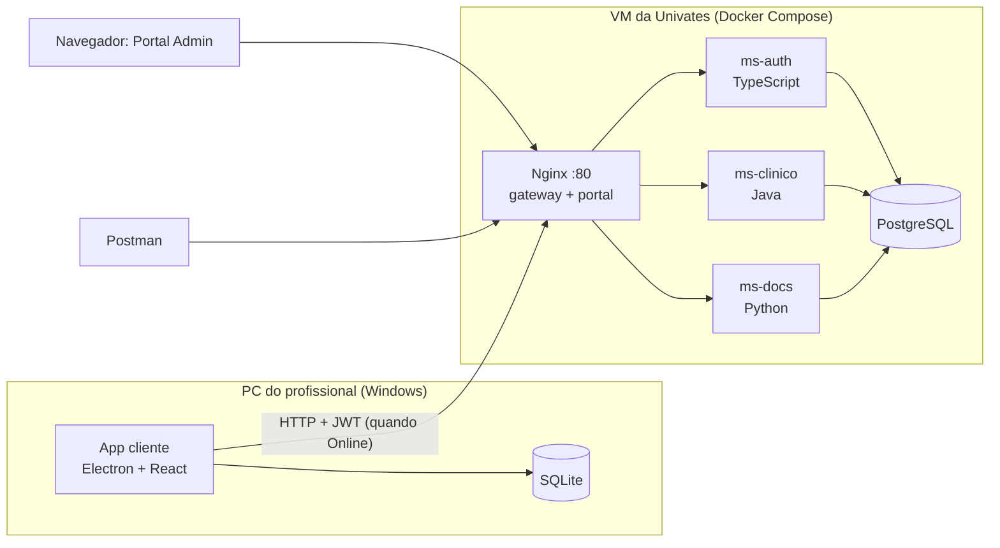

# MedicalField

**Prontuário Médico de Emergência com arquitetura offline-first.** Trabalho final da disciplina 4815206 – Arquiteturas de Software (Univates, 2026/B).

Equipes de resgate (SAMU, ambulâncias de rodovia, equipes em desastres) muitas vezes atendem sem internet. No MedicalField, o profissional registra o paciente, o prontuário e a ficha de atendimento num **app que funciona sem conexão**. Quando a conexão volta, os dados são sincronizados com um **backend de microsserviços em três linguagens**, **sem duplicar**, **sem perder a origem** de cada registro e **resolvendo conflitos**. Os registros podem ser consultados num **portal administrativo**, exportados em **PDF** e enviados por **e-mail**.



## Componentes

| Componente | Pasta | Linguagem / tecnologia | O que faz |
|---|---|---|---|
| App cliente | [`apps/cliente`](apps/cliente) | Electron, React, TypeScript, SQLite | Uso em campo, online e offline, com a chave "Simular Conectividade" |
| Portal Admin | [`apps/portal`](apps/portal) | React, TypeScript | Consulta de atendimentos, prontuários, cadastros, logs e conflitos |
| ms-auth | [`servicos/ms-auth`](servicos/ms-auth) | TypeScript (Node.js) | Login, sessão, tokens, profissionais e auditoria |
| ms-clinico | [`servicos/ms-clinico`](servicos/ms-clinico) | Java (Spring Boot) | Pessoas, prontuários, atendimentos, medicamentos e sincronização |
| ms-docs | [`servicos/ms-docs`](servicos/ms-docs) | Python (FastAPI) | PDF da ficha de atendimento e envio por e-mail |
| Infraestrutura | [`infra`](infra) | Docker Compose, Nginx, PostgreSQL | Tudo que roda na VM |

## Documentação

Comece por [`docs/README.md`](docs/README.md). Os principais:

- [Enunciado](docs/01-enunciado.md) e [requisitos](docs/02-requisitos.md): o que precisa ser feito.
- [Decisões](docs/03-decisoes.md): o que decidimos e por quê.
- [Arquitetura](docs/04-arquitetura.md), [modelo de dados](docs/05-modelo-de-dados.md) e [API](docs/06-api.md): como o sistema é.
- [Sincronização](docs/07-sincronizacao.md) e [segurança e auditoria](docs/08-seguranca-e-auditoria.md): as partes mais delicadas.
- [Roteiro de testes](docs/11-roteiro-de-testes.md) e [implantação](docs/12-implantacao.md): como apresentar e como colocar no ar.

## Andamento

| Etapa | Conteúdo | Situação |
|---|---|---|
| 1 | Repositório, documentação e infraestrutura base (PostgreSQL + Nginx) | **Concluída** |
| 2 | ms-auth: login, sessão, profissionais, logs e o middleware de log | Pendente |
| 3 | ms-clinico: cadastros, idempotência, unificação de duplicados, "receber dados" e dados de demonstração | Pendente |
| 4 | ms-docs: PDF e e-mail | Pendente |
| 5 | Portal Admin | Pendente |
| 6 | App cliente (Electron): telas, SQLite, login offline, chave, fila, sincronização | Pendente |
| 7 | Coleção do Postman, testes automatizados e geração do `.exe` | Pendente |
| 8 | Implantação na VM e ensaio do roteiro de testes completo | Pendente |

## Como rodar (etapa atual)

Pré-requisitos: Docker com Compose. Na VM, ver [docs/12-implantacao.md](docs/12-implantacao.md).

```bash
cd infra
cp .env.example .env    # e troque as senhas
docker compose up -d
```

- `http://localhost/` mostra a página provisória do portal.
- `http://localhost/api/...` responde `503 SERVICO_INDISPONIVEL` até cada serviço ser implantado.
- `./scripts/psql.sh` abre o banco.

## Convenções

- **Idioma:** documentação, nomes do domínio e rotas em português, como no enunciado. Termos técnicos do código em inglês (`Controller`, `Repository`…).
- **Git:** a `main` só recebe trabalho pronto. Cada etapa é feita numa branch (`etapa-2-ms-auth`, por exemplo) e entra na `main` quando concluída.
- **Fim de linha:** LF em tudo (garantido pelo `.gitattributes`), porque scripts com CRLF quebram no Linux.
- **Segredos:** nunca no Git. Senhas ficam em `infra/.env` e chaves em `infra/secrets/`. O modelo de configuração é o `infra/.env.example`.
