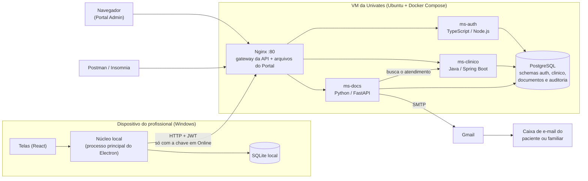

# 4. Arquitetura

Visão geral dos componentes, onde cada um roda, como eles conversam, as tecnologias e os padrões de projeto usados. É o entregável "Modelo de arquitetura: desenho + tecnologias utilizadas".

---

## 4.1 Desenho geral



**Em uma frase:** o profissional usa um app desktop que grava tudo num banco local e sincroniza, quando há conexão, com três microsserviços na VM. Eles ficam atrás de um único Nginx, que também entrega o portal administrativo.

---

## 4.2 Componentes

| Componente | Responsabilidade | Tecnologia | Onde roda | Porta |
|---|---|---|---|---|
| **App cliente** | Interface do profissional: login (online e offline), ficha de atendimento, chave Online/Offline, fila de pendentes, sincronização | Electron + React + TypeScript + SQLite | PC do profissional (Windows) | — |
| **Portal Admin** | Interface administrativa: login, listagens, detalhes, PDF, e-mail, logs, conflitos, documentação da API | React + TypeScript (arquivos estáticos) | Navegador, servido pelo Nginx | 80 (via Nginx) |
| **Nginx** | Porta única do sistema (API Gateway): encaminha `/api/...` ao serviço certo, repassa o IP real e entrega o portal | Nginx | VM (Docker) | **80 (pública)** |
| **ms-auth** | Login, sessão e tokens, profissionais, auditoria (recebe os logs dos clientes e lista os logs) | TypeScript (Node.js, Fastify) | VM (Docker) | 3000 (interna) |
| **ms-clinico** | Pessoas, prontuários, atendimentos, medicamentos, idempotência, unificação de duplicados e "receber dados" | Java 21 (Spring Boot) | VM (Docker) | 8080 (interna) |
| **ms-docs** | PDF da Ficha de Atendimento, envio por e-mail e histórico de envios | Python 3.13 (FastAPI) | VM (Docker) | 8000 (interna) |
| **PostgreSQL** | Banco central, com um schema por serviço + auditoria | PostgreSQL 18 | VM (Docker) | 5433 (só `127.0.0.1`) |

### Dentro do app cliente

O Electron tem duas partes, e a divisão entre elas é parte da arquitetura:

| Parte | O que faz | O que **não** faz |
|---|---|---|
| **Telas** (processo de renderização, React) | Mostra e coleta dados | Nunca acessa o SQLite nem a rede diretamente |
| **Núcleo local** (processo principal, Node.js/TypeScript) | Repositórios do SQLite, fila (outbox), cliente HTTP, motor de sincronização, estado da conectividade, sessão e login offline, logs locais | Não depende do Electron: o cofre, a janela "Salvar como" e a rede chegam de fora, por isso roda nos testes com o Node.js puro |

As telas chamam o núcleo por uma API pequena e tipada (`ApiDoNucleo`, em `apps/cliente/src/comum/contrato.ts`), pelo IPC do Electron:

- o *preload* expõe só duas funções em `window.medicalfield`: chamar um método do contrato e ouvir os avisos do núcleo ("o estado mudou", "os dados mudaram");
- o processo principal só atende os métodos do contrato, e só vindos da janela do próprio app;
- as telas rodam com `contextIsolation` e `sandbox`, sem Node.js, e a política de conteúdo (CSP) não deixa a página falar com a rede.

Isso isola a interface das regras de dados, que é exatamente a sugestão do **Repository Pattern** no enunciado.

| Pasta (`apps/cliente/src/`) | O que tem |
|---|---|
| `main/index.ts` | Janela, perfil (`--perfil`, D-29), cofre (`safeStorage`), "Salvar como" do PDF e o IPC |
| `main/nucleo/` | `nucleo.ts` (a fachada que as telas usam), `banco.ts` e `migracoes.ts` (SQLite), `repositorios/`, `conectividade.ts` (Observer), `http.ts`, `sessao.ts` e `credencial.ts` (login offline), `registros.ts` (gravação local), `comandos.ts` (Command), `sincronizacao.ts` (motor), `auditoria.ts` (logs locais) |
| `preload/index.ts` | A ponte `window.medicalfield` |
| `comum/contrato.ts` | O contrato entre as telas e o núcleo |
| `renderer/` | As telas (React + Mantine): `paginas/`, `formularios/`, `componentes/` |

---

## 4.3 Comunicação

| De → Para | Como | Observação |
|---|---|---|
| App cliente → Nginx | HTTP/JSON + `Authorization: Bearer` | Só com a chave em Online. Envia `X-Dispositivo-Id` e `X-Dispositivo-Nome` |
| Portal → Nginx | HTTP/JSON + Bearer | Mesmo endereço do portal (sem CORS) |
| Postman → Nginx | HTTP/JSON + Bearer | Coleção em `postman/`, com login automático |
| Nginx → serviços | HTTP na rede interna do Docker | Caminho repassado sem mudança; IP real em `X-Real-IP` |
| ms-docs → ms-clinico | HTTP interno, repassando o token de quem pediu | O ms-clinico registra esse acesso no log também |
| Serviços → PostgreSQL | Conexão com o usuário do próprio serviço | Cada um só enxerga o seu schema; log de acesso só com `INSERT` |
| ms-docs → Gmail | SMTP com TLS (porta 587) | Atrás de um Adapter, para trocar de provedor por configuração |

Os serviços **não** dependem uns dos outros para validar token: cada um confere o JWT com a chave pública. A única chamada entre serviços é a do ms-docs ao ms-clinico.

---

## 4.4 Rede e portas na VM

```
Internet ──► :80  Nginx ──► rede interna do Docker ──► ms-auth:3000
                                                   ├─► ms-clinico:8080
                                                   └─► ms-docs:8000
         ──► :22  SSH (administração)

127.0.0.1:5433 ──► PostgreSQL (só a própria VM; de fora, via túnel SSH)
```

- O Postgres do projeto roda num container próprio, **separado** de qualquer Postgres que já exista na VM (que costuma usar a porta 5432).
- O Nginx descobre os serviços pelo DNS interno do Docker **na hora da requisição**. Assim ele sobe mesmo se um serviço estiver parado, e responde `503 SERVICO_INDISPONIVEL` para as rotas dele.
- Mapa de rotas → serviço: [06-api.md](06-api.md#61-visão-geral). A configuração está em [`infra/nginx/conf.d/medicalfield.conf`](../infra/nginx/conf.d/medicalfield.conf).

---

## 4.5 Padrões de projeto

O enunciado sugere três padrões e pede mais três de livre escolha.

| Padrão | Onde | Para quê |
|---|---|---|
| **Repository** (sugerido) | App cliente: um repositório por tabela do SQLite (`RepositorioPessoas`, `RepositorioProntuarios`, `RepositorioAtendimentos`, `RepositorioMedicamentos`, `RepositorioOutbox`, `RepositorioLogs`, `RepositorioCredenciais`, `RepositorioSessao`, `RepositorioConfig`), os únicos com SQL; as telas só veem o contrato do núcleo. No ms-clinico, as classes `Repositorio*` concentram todo o SQL de cada tabela; no ms-docs, o `RepositorioEnvios` | As telas e os serviços não sabem de onde vêm os dados; trocar o armazenamento não mexe no resto |
| **Strategy** (sugerido) | ms-clinico: `EstrategiaDeMesclagem` com `MaisRecenteVence` e `ServidorVence` | Regra de resolução de conflitos trocável por configuração |
| **Observer** (sugerido) | App cliente: `EstadoConectividade` avisa o motor de sincronização (Online → sincroniza), o cliente HTTP (Offline → cancela o que está saindo) e o núcleo, que grava a posição e avisa as telas. No portal, o `ArmazemDaSessao` avisa as telas quando a sessão muda (entrou, renovou, terminou) | Disparar o envio da fila sozinho quando a conexão volta |
| **Command** (escolhido) | App cliente: cada item da outbox vira um comando (`CriarPessoa`, `CriarProntuario`, `CriarAtendimento`, `EnviarEmail`, em `comandos.ts`) com `requisicao()` (o que enviar), `aplicar()` (o que fazer com a resposta, inclusive a unificação), `aoFalhar()` e `descrever()` (o texto da tela da fila) | O motor envia e trata operações de tipos diferentes do mesmo jeito, na ordem certa |
| **Adapter** (escolhido) | ms-docs: interface `EnvioDeEmail` com o `EnvioPorSmtp`, que adapta o `smtplib` (Gmail), e o `EnvioDesativado`, usado quando o SMTP não foi configurado | Trocar o provedor de e-mail (por exemplo, por uma API HTTP) sem mexer nas rotas nem na idempotência |
| **Builder** (escolhido) | ms-docs: `FichaPdfBuilder` monta o PDF por partes (cabeçalho, paciente, prontuário, ocorrência, triagem, avaliação, medicamentos, desfecho, rastreabilidade) e o `MontadorDaFicha` (o "diretor") chama as partes na ordem | Montar um documento complexo passo a passo e de forma legível |

Padrões de **arquitetura** que também aparecem: **API Gateway** (Nginx), **Outbox** (fila de pendentes), **Database per Service** (um schema e um usuário por serviço) e **Offline-First**.

---

## 4.6 Tecnologias

| Parte | Tecnologias principais |
|---|---|
| ms-auth | Node.js (LTS), TypeScript, Fastify, node-postgres, bcrypt, `jose` (JWT RS256), migrations SQL |
| ms-clinico | Java 21, Spring Boot 4 (Web MVC, Validation, JDBC com `JdbcClient`), Flyway, Nimbus JOSE + JWT (confere o token), springdoc-openapi |
| ms-docs | Python 3.13, FastAPI, Uvicorn, SQLAlchemy Core + Alembic, psycopg 3, PyJWT (confere o token), httpx (chama o ms-clinico), Jinja2 + WeasyPrint (HTML → PDF), smtplib |
| Portal | React 19, TypeScript, Vite, BoardUI (Tailwind CSS v4 + React Aria, D-44), React Router, TanStack Query, Swagger UI. Servido pelo Nginx (D-40) |
| App cliente | Electron 45 (Node.js 24), React 19, TypeScript, electron-vite, Mantine 9, TanStack Query, SQLite pelo `node:sqlite` do próprio Electron (D-45), `safeStorage` (cofre do Windows), electron-builder (instalador NSIS) |
| Infraestrutura | Docker Compose, Nginx, PostgreSQL 18 |
| Qualidade e entrega | Testes automatizados por parte, coleção do Postman (Newman), GitHub Actions com o sistema inteiro no Docker e o Mailpit como e-mail de teste, e o `.exe` do cliente gerado e testado no Windows (D-48) |

As versões exatas ficam nos arquivos de build de cada parte (`package.json` e `package-lock.json`, `pom.xml`, `pyproject.toml` e `requirements.txt`).

---

## 4.7 Estrutura do repositório

```
offline-first-medical-record/
├── docs/                  documentação (este conjunto de arquivos)
├── infra/                 Docker Compose, Nginx, inicialização do Postgres, scripts
│   ├── docker-compose.yml
│   ├── .env.example
│   ├── nginx/
│   ├── postgres/init/
│   ├── scripts/
│   └── secrets/           chaves JWT (fora do Git)
├── servicos/
│   ├── ms-auth/           TypeScript
│   ├── ms-clinico/        Java
│   └── ms-docs/           Python
├── apps/
│   ├── compartilhado/     tipos da API, rótulos e formatação (portal e cliente, D-41)
│   ├── portal/            Portal Admin (React); o Dockerfile gera a imagem do Nginx com o portal
│   └── cliente/           App cliente (Electron)
├── postman/               coleção e ambiente do Postman (roda também pelo Newman)
└── .github/workflows/     testes a cada push e o instalador do Windows (D-48)
```
