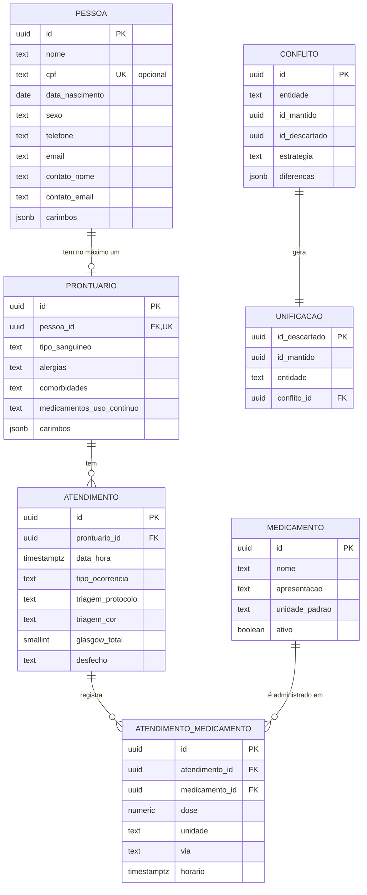
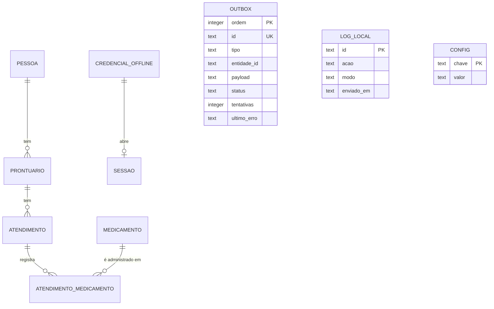

# 5. Modelo de dados

O MedicalField tem **dois bancos** (a "persistência dual" pedida no enunciado):

| Banco | Onde fica | Tecnologia | Papel |
|---|---|---|---|
| **Central** | VM da Univates (container Docker) | PostgreSQL 18 | Fonte da verdade: consolida prontuários, atendimentos e auditoria |
| **Local** | Dispositivo do profissional (app cliente) | SQLite (arquivo embarcado no app) | Permite trabalhar sem conexão: cópia dos dados do servidor + o que foi criado no aparelho + fila de pendentes |

Este documento descreve as tabelas dos dois. Como os dados se movem entre eles está em [07-sincronizacao.md](07-sincronizacao.md).

---

## 5.1 Convenções (valem para os dois bancos)

- **Nomes** em português, `snake_case` no banco e `camelCase` no JSON da API (ex.: `data_nascimento` ↔ `dataNascimento`).
- **IDs** são UUID (de preferência v7, que é ordenado pelo tempo). Quem cria o registro gera o ID — no modo offline, quem cria é o cliente. O servidor aceita qualquer UUID válido. Só os cadastros feitos direto no banco (medicamentos, profissionais) usam o valor padrão gerado pelo Postgres.
- **Datas e horas** são gravadas em UTC (`timestamptz` no Postgres, texto ISO 8601 no SQLite) e mostradas no horário de Brasília (`America/Sao_Paulo`).
- **Listas fixas de valores** (tipo de registro, cor da triagem etc.) são texto com `CHECK`, em maiúsculas e sem acento (ex.: `OBSTETRICA`). As telas mostram o rótulo bonito.
- **Registros clínicos são imutáveis.** A aplicação não faz `UPDATE` nem `DELETE` em pessoa, prontuário e atendimento. A única exceção é o servidor juntando registros duplicados (ver [7.6](07-sincronizacao.md#76-unificação-de-duplicados-conflitos)).
- **Nada é apagado.** Um medicamento que sai de uso fica com `ativo = false`.
- **Sem chave estrangeira entre schemas de serviços diferentes.** Cada serviço confia nos IDs do outro e confere pela API quando precisa (ex.: o ms-docs busca o atendimento no ms-clinico).

### Bloco de origem (rastreabilidade)

Pessoa, prontuário e atendimento têm as mesmas colunas de rastreabilidade. Elas respondem "quem registrou, quando, de onde, em que modo, e quem mandou pro servidor":

| Coluna | Tipo | Regra | O que guarda |
|---|---|---|---|
| `criado_por_id` | uuid | obrigatória | ID do profissional que registrou |
| `criado_por_nome` | text | obrigatória | Nome dele **no momento do registro** |
| `criado_por_registro` | text | obrigatória | Ex.: `CRM 12345-RS` |
| `criado_em` | timestamptz | obrigatória | Data/hora do registro, pelo relógio do dispositivo. É o "carimbo de data/hora do profissional" usado na regra de conflito |
| `dispositivo_id` | uuid | opcional | Dispositivo de origem (vazio quando veio direto pela API, ex.: Postman) |
| `dispositivo_nome` | text | opcional | Ex.: `Ambulância 01` |
| `modo_registro` | text | `ONLINE` ou `OFFLINE` | Posição da chave de conectividade quando o registro foi feito |
| `sincronizado_por_id` | uuid | obrigatória | Profissional dono do token que enviou o registro ao servidor (pode ser outro, ver D-25) |
| `recebido_em` | timestamptz | padrão `now()` | Quando o servidor recebeu (relógio do servidor) |
| `atualizado_em` | timestamptz | padrão `now()` | Última mudança no servidor. Só muda numa unificação. É o que o "receber dados" usa para saber o que mudou |

Na API esse bloco aparece como dois objetos: `origem` (o que o cliente informa) e `sincronizacao` (o que o servidor preenche). Ver [06-api.md](06-api.md#64-formatos-comuns).

---

## 5.2 Banco central (PostgreSQL)

Um banco (`medicalfield`) com **um schema por serviço**. Cada serviço tem o próprio usuário no banco e só enxerga o seu schema. O script [`infra/postgres/init/01-estrutura.sh`](../infra/postgres/init/01-estrutura.sh) cria usuários, schemas e permissões. Cada serviço cria as **próprias tabelas** com as próprias migrations.

| Schema | Dono (usuário do banco) | Tabelas | Quem mais acessa |
|---|---|---|---|
| `auth` | ms-auth (`ms_auth`) | `profissional`, `sessao` | ninguém |
| `clinico` | ms-clinico (`ms_clinico`) | `pessoa`, `prontuario`, `atendimento`, `atendimento_medicamento`, `medicamento`, `unificacao`, `conflito` | ninguém |
| `documentos` | ms-docs (`ms_docs`) | `envio_email` | ninguém |
| `auditoria` | ms-auth (`ms_auth`) | `log_acesso`, `log_cliente` | ms-clinico e ms-docs: **só INSERT** |

### Diagrama (schema `clinico`)



> O diagrama mostra só as colunas principais. Pessoa, prontuário e atendimento também têm o **bloco de origem** completo.

### `auth.profissional`

Quem pode entrar no sistema. Cadastrado direto no banco (o enunciado permite), por isso a senha é bcrypt: dá para gerar no próprio SQL com `crypt()`.

| Coluna | Tipo | Regra | Descrição |
|---|---|---|---|
| `id` | uuid | PK, padrão `uuidv7()` | |
| `nome` | text | obrigatória | Ex.: `Dra. Ana Souza` |
| `tipo_registro` | text | `CRM`, `COREN` ou `SOCORRISTA` | Conselho/identificação usada no login |
| `registro` | text | obrigatória | Ex.: `12345-RS`, `543210-RS`, `SOC-0001` |
| `perfil` | text | `ADMIN` ou `OPERACIONAL`, padrão `OPERACIONAL` | `ADMIN` entra no portal (ex.: médico regulador) |
| `senha_hash` | text | obrigatória | bcrypt |
| `ativo` | boolean | padrão `true` | Inativo não entra (nem online, nem offline depois de revalidar) |
| `tentativas_falhas` | integer | padrão `0` | Senhas erradas seguidas |
| `bloqueado_ate` | timestamptz | opcional | Preenchido após 5 erros seguidos (bloqueio de 5 min) |
| `criado_em` | timestamptz | padrão `now()` | |

Índice único em `(tipo_registro, upper(registro))`: o mesmo registro não se repete, e maiúsculas/minúsculas não importam no login.

Exemplo de cadastro manual:

```sql
INSERT INTO auth.profissional (nome, tipo_registro, registro, perfil, senha_hash)
VALUES ('Dra. Ana Souza', 'CRM', '12345-RS', 'OPERACIONAL', crypt('Senha@123', gen_salt('bf', 10)));
```

### `auth.sessao`

Uma linha por login online. Guarda o refresh token (só o hash).

| Coluna | Tipo | Regra | Descrição |
|---|---|---|---|
| `id` | uuid | PK | Vai no token de acesso (`sid`) |
| `profissional_id` | uuid | FK → `profissional` | |
| `refresh_token_hash` | text | único | SHA-256 do refresh token |
| `dispositivo_id` | uuid | opcional | |
| `dispositivo_nome` | text | opcional | `Portal` quando o login vem do portal |
| `criada_em` | timestamptz | padrão `now()` | |
| `expira_em` | timestamptz | obrigatória | `criada_em + 7 dias` (não é estendida) |
| `ultimo_uso_em` | timestamptz | opcional | Último refresh |
| `revogada_em` | timestamptz | opcional | Preenchida no logout |

### `clinico.pessoa`

| Coluna | Tipo | Regra | Descrição |
|---|---|---|---|
| `id` | uuid | PK | Gerado por quem criou |
| `nome` | text | obrigatória | Paciente sem identificação: o profissional escreve algo como `Desconhecido` |
| `cpf` | text | opcional; 11 dígitos; **único quando preenchido** | Só números. Dígitos verificadores conferidos no cliente e no servidor |
| `data_nascimento` | date | opcional | |
| `sexo` | text | `MASCULINO`, `FEMININO`, `OUTRO` ou `NAO_INFORMADO` | opcional |
| `telefone` | text | opcional | |
| `email` | text | opcional | Usado no envio da ficha "para o paciente" |
| `contato_nome` | text | opcional | Familiar/contato de emergência |
| `contato_parentesco` | text | opcional | Ex.: `Mãe` |
| `contato_telefone` | text | opcional | |
| `contato_email` | text | opcional | Usado no envio da ficha "para o familiar" |
| `carimbos` | jsonb | obrigatória | Data/hora de origem de cada campo (`{"telefone": "2026-11-03T13:00:00Z", ...}`). Usado pela regra "mais recente vence" numa unificação |
| *bloco de origem* | | | ver [5.1](#bloco-de-origem-rastreabilidade) |

Índices: único parcial em `cpf` (`WHERE cpf IS NOT NULL`), e em `atualizado_em`.

### `clinico.prontuario`

O histórico clínico fixo da pessoa. **No máximo um por pessoa.**

| Coluna | Tipo | Regra | Descrição |
|---|---|---|---|
| `id` | uuid | PK | |
| `pessoa_id` | uuid | FK → `pessoa`, **único** | |
| `tipo_sanguineo` | text | `A+`, `A-`, `B+`, `B-`, `AB+`, `AB-`, `O+`, `O-` ou `DESCONHECIDO` | opcional |
| `alergias` | text | opcional | Texto livre |
| `comorbidades` | text | opcional | Ex.: hipertensão, diabetes |
| `medicamentos_uso_continuo` | text | opcional | |
| `observacoes` | text | opcional | |
| `carimbos` | jsonb | obrigatória | Igual ao da pessoa |
| *bloco de origem* | | | |

### `clinico.atendimento`

Cada ocorrência de socorro: é a **Ficha de Atendimento**. Os campos estão explicados em [09-ficha-e-dominio.md](09-ficha-e-dominio.md).

| Coluna | Tipo | Regra |
|---|---|---|
| `id` | uuid | PK |
| `prontuario_id` | uuid | FK → `prontuario`, obrigatória |
| `data_hora` | timestamptz | obrigatória (quando o atendimento aconteceu) |
| `local_ocorrencia` | text | opcional |
| `tipo_ocorrencia` | text | `CLINICA`, `TRAUMA`, `OBSTETRICA`, `PSIQUIATRICA` ou `OUTRO` |
| `queixa_principal` | text | obrigatória |
| `triagem_protocolo` | text | `MANCHESTER` ou `START` |
| `triagem_cor` | text | Manchester: `VERMELHO`, `LARANJA`, `AMARELO`, `VERDE`, `AZUL`. START: `VERMELHO`, `AMARELO`, `VERDE`, `PRETO` (um `CHECK` garante a combinação) |
| `glasgow_ocular` | smallint | 1 a 4, opcional |
| `glasgow_verbal` | smallint | 1 a 5, opcional |
| `glasgow_motora` | smallint | 1 a 6, opcional |
| `glasgow_total` | smallint | **calculada pelo banco** (soma dos três). Regra: ou os três preenchidos, ou nenhum |
| `pa_sistolica` / `pa_diastolica` | smallint | mmHg; 0–300 / 0–200; opcional |
| `freq_cardiaca` | smallint | bpm; 0–300; opcional |
| `freq_respiratoria` | smallint | irpm; 0–80; opcional |
| `spo2` | smallint | %; 0–100; opcional |
| `temperatura` | numeric(4,1) | °C; 25,0–45,0; opcional |
| `glicemia` | smallint | mg/dL; 0–1500; opcional |
| `procedimentos` | text | opcional |
| `desfecho` | text | `ENCAMINHADO_HOSPITAL`, `LIBERADO_NO_LOCAL`, `RECUSOU_ATENDIMENTO` ou `OBITO` |
| `destino` | text | obrigatória quando o desfecho é `ENCAMINHADO_HOSPITAL` (nome do hospital) |
| `observacoes` | text | opcional |
| *bloco de origem* | | |

Índices em `prontuario_id`, `data_hora` e `atualizado_em`.

### `clinico.atendimento_medicamento`

Os medicamentos administrados num atendimento (zero ou mais). São gravados junto com o atendimento, na mesma transação.

| Coluna | Tipo | Regra |
|---|---|---|
| `id` | uuid | PK (gerado pelo cliente) |
| `atendimento_id` | uuid | FK → `atendimento` |
| `medicamento_id` | uuid | FK → `medicamento` |
| `dose` | numeric(10,3) | maior que zero |
| `unidade` | text | `MG`, `MCG`, `G`, `ML`, `UI`, `GOTA`, `COMPRIMIDO`, `AMPOLA` ou `OUTRA` |
| `via` | text | `INTRAVENOSA`, `INTRAMUSCULAR`, `SUBCUTANEA`, `ORAL`, `SUBLINGUAL`, `INALATORIA`, `INTRAOSSEA`, `TOPICA` ou `OUTRA` |
| `horario` | timestamptz | obrigatória |
| `observacao` | text | opcional |

### `clinico.medicamento`

Catálogo ("cadastro de apoio"). **Inserido direto no banco**, como pede o passo 9 do roteiro.

| Coluna | Tipo | Regra |
|---|---|---|
| `id` | uuid | PK, padrão `uuidv7()` |
| `nome` | text | obrigatória |
| `apresentacao` | text | opcional (ex.: `Ampola 1 mg/ml`) |
| `unidade_padrao` | text | mesma lista de `unidade`; padrão `MG` |
| `ativo` | boolean | padrão `true` |
| `criado_em` | timestamptz | padrão `now()` |
| `atualizado_em` | timestamptz | padrão `now()`; um gatilho atualiza em todo `UPDATE` (até nos feitos à mão) |

Índice único em `(lower(nome), lower(coalesce(apresentacao, '')))`, para evitar o mesmo medicamento duas vezes.

Exemplo de cadastro manual (passo 9 do roteiro):

```sql
INSERT INTO clinico.medicamento (nome, apresentacao, unidade_padrao)
VALUES ('Cetoprofeno', 'Frasco-ampola 100 mg', 'MG');
```

Como `id`, `criado_em` e `atualizado_em` têm valor padrão, o insert manual já aparece no próximo "receber dados" do cliente.

### `clinico.unificacao`

"Apelidos": quando o servidor junta dois registros duplicados, o ID descartado passa a apontar para o mantido. Qualquer coisa que chegar depois referenciando o ID descartado é traduzida automaticamente.

| Coluna | Tipo | Regra |
|---|---|---|
| `id_descartado` | uuid | PK |
| `id_mantido` | uuid | obrigatória |
| `entidade` | text | `PESSOA` ou `PRONTUARIO` |
| `conflito_id` | uuid | FK → `conflito` |
| `criado_em` | timestamptz | padrão `now()` |

### `clinico.conflito`

Registro de cada unificação, para auditoria e para o portal.

| Coluna | Tipo | Regra | Descrição |
|---|---|---|---|
| `id` | uuid | PK | |
| `entidade` | text | `PESSOA` ou `PRONTUARIO` | |
| `motivo` | text | `CPF_DUPLICADO` ou `PRONTUARIO_DUPLICADO` | |
| `id_mantido` | uuid | | Registro que ficou |
| `id_descartado` | uuid | | Registro que chegou e foi absorvido |
| `estrategia` | text | `MAIS_RECENTE_VENCE` ou `SERVIDOR_VENCE` | Regra que estava configurada |
| `diferencas` | jsonb | | Lista `{campo, tipo, valorMantido, valorDescartado, origemDoValor}`. `tipo` é `CONFLITO` (os dois preenchidos e diferentes) ou `COMPLEMENTO` (só o que chegou estava preenchido) |
| `dados_recebidos` | jsonb | | O registro que chegou, completo |
| `detectado_em` | timestamptz | padrão `now()` | |
| `sincronizado_por_id` | uuid | | Quem enviou o registro duplicado |
| `dispositivo_id` / `dispositivo_nome` | | opcionais | De onde veio o duplicado |

### `documentos.envio_email`

Cada pedido de envio da ficha por e-mail. O `id` é gerado por quem pede e serve de **chave de idempotência**: pedir de novo com o mesmo ID não manda dois e-mails (D-36). Só entra aqui o pedido que chegou a tentar o envio; pedido recusado na validação, atendimento inexistente ou destinatário sem e-mail não gravam nada. A tabela é criada pela migration do Alembic do ms-docs (`servicos/ms-docs/migracoes/`), que registra a versão aplicada em `documentos.alembic_version`.

| Coluna | Tipo | Regra |
|---|---|---|
| `id` | uuid | PK |
| `atendimento_id` | uuid | obrigatória (sem FK: é de outro schema, de outro serviço) |
| `destinatario_tipo` | text | `PACIENTE`, `FAMILIAR` ou `OUTRO` |
| `destinatario_email` | text | obrigatória. O endereço usado de fato (o da pessoa, o do contato ou o informado) |
| `status` | text | `ENVIADO` ou `ERRO` |
| `erro` | text | motivo da última falha (ex.: "O servidor de e-mail não respondeu."). Obrigatória quando `ERRO`; vazia depois que o envio dá certo |
| `tentativas` | integer | começa em `1`; cada nova tentativa com o mesmo ID soma 1 |
| `solicitado_por_id` | uuid | profissional do token do primeiro pedido |
| `dispositivo_id` | uuid | opcional (cabeçalho `X-Dispositivo-Id`) |
| `solicitado_em` | timestamptz | primeiro pedido |
| `ultima_tentativa_em` | timestamptz | última tentativa de envio |
| `enviado_em` | timestamptz | preenchida se, e só se, `status = ENVIADO` |

Índices: `(solicitado_em DESC, id DESC)` para o histórico e `(atendimento_id, solicitado_em DESC)` para o filtro por atendimento.

### `auditoria.log_acesso`

Uma linha por requisição HTTP recebida por **qualquer** um dos três serviços (o middleware de log do enunciado). Os campos em negrito são os exigidos pelo enunciado.

| Coluna | Tipo | Descrição |
|---|---|---|
| `id` | uuid | PK, padrão `uuidv7()` |
| **`data_hora`** | timestamptz | Início da requisição |
| `servico` | text | `ms-auth`, `ms-clinico` ou `ms-docs` |
| **`ip_cliente`** | text | IP real de quem chamou (cabeçalho `X-Real-IP`, preenchido pelo Nginx) |
| **`profissional_id`** | uuid | Do token; vazio quando a requisição não tinha token válido (ex.: login) |
| **`metodo`** | text | `GET`, `POST`... |
| **`rota`** | text | Caminho chamado, sem a query string (ex.: `/api/atendimento`) |
| **`status_code`** | smallint | Status da resposta |
| **`tempo_ms`** | integer | Tempo de processamento em milissegundos |
| `dispositivo_id` | uuid | Do cabeçalho `X-Dispositivo-Id`, quando houver |
| `user_agent` | text | Ajuda a separar cliente, portal e Postman |

### `auditoria.log_cliente`

As ações feitas no app cliente (principalmente offline), recebidas pelo `POST /log`.

| Coluna | Tipo | Descrição |
|---|---|---|
| `id` | uuid | PK, gerado no cliente (reenvio não duplica) |
| `profissional_id` | uuid | Quem fez a ação (vazio, por exemplo, numa tentativa de login que falhou) |
| `dispositivo_id` | uuid | obrigatória |
| `dispositivo_nome` | text | |
| `data_hora` | timestamptz | Quando aconteceu, pelo relógio do dispositivo |
| `acao` | text | Ex.: `LOGIN_OFFLINE`, `ATENDIMENTO_CRIADO` (lista em [08](08-seguranca-e-auditoria.md#810-log-do-cliente)) |
| `modo` | text | `ONLINE` ou `OFFLINE` |
| `detalhes` | jsonb | Ex.: `{"atendimentoId": "..."}` |
| `enviado_por_id` | uuid | Dono do token que enviou o lote |
| `recebido_em` | timestamptz | padrão `now()` |

**Imutabilidade:** as duas tabelas de auditoria têm um gatilho que recusa qualquer `UPDATE`, `DELETE` ou `TRUNCATE` (até do superusuário), e ms-clinico e ms-docs só têm permissão de `INSERT`. Log não se altera nem se apaga.

---

## 5.3 Banco local (SQLite, no app cliente)

Um arquivo SQLite por dispositivo, criado automaticamente na pasta de dados do app no Windows (`%APPDATA%\MedicalField\<perfil>\medicalfield.db`). Quem acessa é só o processo principal do Electron (ver [04-arquitetura.md](04-arquitetura.md)), pelo módulo `node:sqlite` que já vem no Electron (D-45).

- **Migrations do próprio app:** `apps/cliente/src/main/nucleo/migracoes.ts`. Cada versão aplicada fica na tabela `migracao`, e o app aplica as que faltam ao abrir o banco.
- **Modo do arquivo:** `journal_mode = WAL` (gravar não bloqueia a leitura das telas), `synchronous = NORMAL` e `busy_timeout = 5000`.
- **Sem chaves estrangeiras:** as setas do diagrama são as ligações lógicas. Quem garante a integridade é o servidor: o que vem dele substitui a cópia local, e um registro recebido nunca pode ser recusado pelo banco do aparelho (por exemplo, um atendimento de outra ambulância que chega antes do prontuário dele).



### Tabelas de dados (espelho do servidor)

`pessoa`, `prontuario`, `atendimento`, `atendimento_medicamento` e `medicamento` têm **as mesmas colunas** do banco central (tipos do SQLite: UUID e datas como `TEXT`, números como `INTEGER`/`REAL`, JSON como `TEXT`). Diferenças:

| Diferença | Por quê |
|---|---|
| Coluna extra `estado_sync` em `pessoa`, `prontuario` e `atendimento`: `PENDENTE`, `SINCRONIZADO` ou `ERRO` | Mostrar na tela o que ainda não subiu (selo "Pendente") |
| Colunas `sincronizado_por_id`, `recebido_em` e `atualizado_em` ficam vazias até o registro ser confirmado pelo servidor | Elas são preenchidas pelo servidor |
| **Não** existe a regra "um prontuário por pessoa" | Quem garante isso é o servidor. Por um instante pode haver dois localmente (um pendente e um recebido), até a unificação resolver |
| O bloco de origem usa os mesmos nomes de colunas; o `modo` se chama `modo_registro` | `modo` sozinho ficaria ambíguo ao lado de `estado_sync` |
| `atendimento_medicamento` tem a coluna `nome`, uma cópia do nome do medicamento | A ficha mostra o nome mesmo antes de o catálogo chegar ao aparelho |
| O contato do familiar fica em quatro colunas (`contato_nome`, `contato_parentesco`, `contato_telefone`, `contato_email`) | Iguais às do banco central |

### `outbox` (fila de pendentes)

Cada operação que precisa ir para o servidor. É o padrão **Outbox**; cada item é um **Command** que o motor de sincronização sabe executar.

| Coluna | Tipo | Descrição |
|---|---|---|
| `ordem` | INTEGER | PK autoincremento. Define a ordem de envio (a ordem em que as coisas foram feitas) |
| `id` | TEXT | UUID da operação |
| `tipo` | TEXT | `CRIAR_PESSOA`, `CRIAR_PRONTUARIO`, `CRIAR_ATENDIMENTO` ou `ENVIAR_EMAIL` |
| `entidade_id` | TEXT | ID do registro. No `ENVIAR_EMAIL`, o ID do atendimento: o ID do pedido é o próprio `id` do item, que é a chave de idempotência do ms-docs (D-36) |
| `payload` | TEXT | JSON exatamente como vai no corpo da requisição |
| `status` | TEXT | `PENDENTE`, `ENVIANDO`, `CONCLUIDO` ou `ERRO` |
| `tentativas` | INTEGER | Quantas vezes já tentou |
| `ultimo_erro` | TEXT | Código e mensagem da última falha |
| `proxima_tentativa_em` | TEXT | Quando pode tentar de novo (espera crescente: 5 s, 10 s, 20 s… até 5 min) |
| `resultado` | TEXT | A resposta do servidor depois de concluído (JSON). No `ENVIAR_EMAIL`, o envio registrado pelo ms-docs: é o que a tela mostra em "E-mails desta ficha" |
| `criado_por_id` | TEXT | Profissional que fez a operação |
| `criado_em` / `concluido_em` | TEXT | |

### `log_local`

| Coluna | Tipo | Descrição |
|---|---|---|
| `id` | TEXT | UUID (vira o `id` em `auditoria.log_cliente`) |
| `profissional_id` | TEXT | |
| `data_hora` | TEXT | |
| `acao` | TEXT | Lista em [08](08-seguranca-e-auditoria.md#810-log-do-cliente) |
| `modo` | TEXT | `ONLINE` ou `OFFLINE` |
| `detalhes` | TEXT | JSON |
| `enviado_em` | TEXT | Vazio enquanto não foi enviado ao servidor |

### `credencial_offline`

Uma linha por profissional que **já entrou online neste dispositivo**. É o que permite o login sem internet ([08](08-seguranca-e-auditoria.md#85-login-offline)).

| Coluna | Tipo | Descrição |
|---|---|---|
| `profissional_id` | TEXT | PK |
| `tipo_registro` / `registro` | TEXT | Únicos juntos |
| `nome` / `perfil` | TEXT | Copiados do último login online |
| `verificador` | TEXT | Hash scrypt da senha (a senha em si nunca é gravada) |
| `sal` | TEXT | Sal aleatório do hash |
| `validado_online_em` | TEXT | Último login online ou renovação de sessão bem-sucedida |
| `tentativas_falhas` | INTEGER | Senhas erradas seguidas no modo offline |
| `bloqueado_ate` | TEXT | Bloqueio de 5 min após 5 erros |

### `credencial_servidor`

A réplica das credenciais do servidor (D-51): uma linha por profissional **ativo**, recebida a cada sincronização completa. Permite o login offline de quem nunca entrou online neste dispositivo ([08](08-seguranca-e-auditoria.md#85-login-offline)). A lista nova substitui a anterior: quem foi desativado sai.

| Coluna | Tipo | Descrição |
|---|---|---|
| `profissional_id` | TEXT | PK |
| `tipo_registro` / `registro` | TEXT | Únicos juntos |
| `nome` / `perfil` | TEXT | Como no servidor |
| `senha_hash_cifrado` | BLOB | O hash bcrypt de `auth.profissional`, cifrado pelo cofre do sistema (DPAPI no Windows). Sem cofre, a tabela fica vazia |
| `recebido_em` | TEXT | Última sincronização que trouxe a lista (a validade de 7 dias conta daqui) |
| `tentativas_falhas` / `bloqueado_ate` | INTEGER / TEXT | Como em `credencial_offline` |

### `sessao`

No máximo uma linha: quem está logado agora.

| Coluna | Tipo | Descrição |
|---|---|---|
| `id` | INTEGER | Sempre 1 |
| `profissional_id` | TEXT | |
| `modo_login` | TEXT | `ONLINE` ou `OFFLINE` (como a sessão começou) |
| `iniciada_em` / `expira_em` | TEXT | |
| `refresh_token_cifrado` | BLOB | Refresh token criptografado pelo cofre do Windows (API `safeStorage` do Electron). Vazio em sessão iniciada offline, e também quando o sistema não tem cofre: aí a senha fica só na memória até o app fechar ([08](08-seguranca-e-auditoria.md#86-sessão-mantida)) |
| `sessao_servidor_expira_em` | TEXT | Validade da sessão no servidor |

O token de acesso (15 min) fica só na memória, nunca em disco.

### `config`

Pares chave/valor: `servidor_url`, `dispositivo_id`, `dispositivo_nome`, `conectividade` (posição da chave: `ONLINE`/`OFFLINE`), `cursor_pull` (marcador do último "receber dados") e `ultima_sincronizacao_em`.

---

## 5.4 O que cada banco tem de cada registro

| Dado | Banco central | Banco local |
|---|---|---|
| Profissionais | todos (`auth.profissional`) | os ativos, com o hash da senha cifrado pelo cofre (`credencial_servidor`, D-51), e um verificador próprio de quem já logou no aparelho (`credencial_offline`). A senha nunca |
| Medicamentos | catálogo completo | cópia completa (recebida do servidor) |
| Pessoas, prontuários, atendimentos | todos | cópia completa (recebida) + os criados no aparelho ainda pendentes |
| Fila de pendentes | — | `outbox` |
| Logs | `auditoria.*` (de todos) | `log_local` (do aparelho, até serem enviados) |
| Conflitos e unificações | `clinico.conflito`, `clinico.unificacao` | aplicados direto nos dados (registro descartado é removido e as referências corrigidas) |
| E-mails enviados | `documentos.envio_email` | pedido fica na `outbox` até ser enviado |
