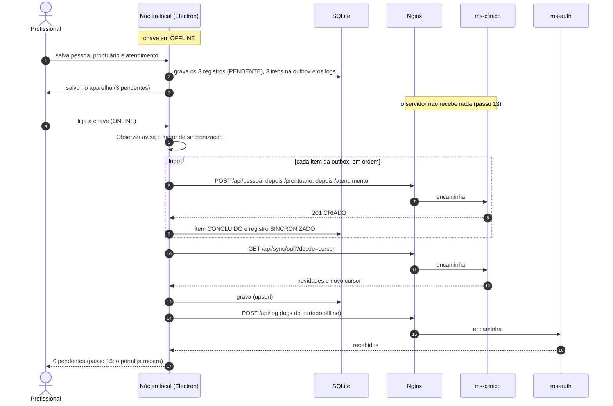
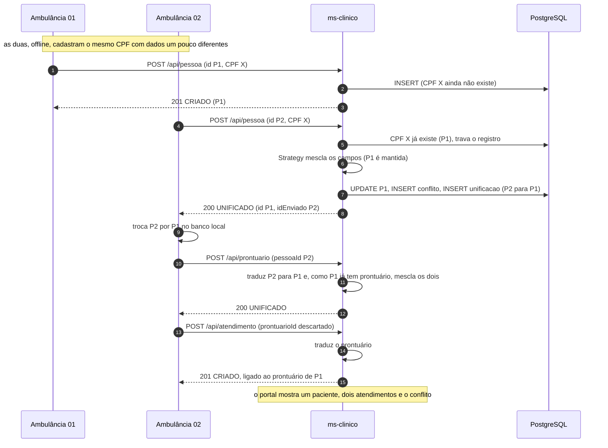

# 7. Sincronização (offline-first)

Como o app cliente funciona sem conexão e como os dados vão e voltam entre o banco local (SQLite) e o servidor. É a parte central do trabalho: offline-first com **idempotência**, **rastreabilidade auditável** e **tratamento de conflitos**.

---

## 7.1 Princípios

1. **O dispositivo nunca depende da rede para trabalhar.** Tudo que o profissional registra é gravado primeiro no SQLite.
2. **Um caminho só para gravar.** Online ou offline, a gravação é a mesma: banco local + fila de pendentes (outbox). A única diferença é que, online, a fila é enviada na hora. Dois caminhos (um para online, outro para offline) seriam o dobro de lugares para bug.
3. **O servidor é a fonte da verdade.** O que vem do servidor substitui a cópia local.
4. **Reenviar é sempre seguro (idempotência).** Todo registro e todo pedido têm um ID criado pelo cliente; o servidor reconhece o que já recebeu.
5. **Registro clínico não muda depois de criado** (D-08). Por isso o único conflito possível é a **mesma coisa criada duas vezes** (ver [7.6](#76-unificação-de-duplicados-conflitos)).

---

## 7.2 A chave Online/Offline

É o botão "Simular Conectividade (Online / Offline)" exigido pelo enunciado. Ela é o **interruptor geral** da comunicação do app com o servidor (D-14):

| Chave | Comportamento |
|---|---|
| **Offline** | O app **não faz nenhuma requisição**, nem de log nem de teste de conexão. O bloqueio fica num lugar só: o cliente HTTP do núcleo local recusa qualquer chamada. É isso que garante o passo 13 do roteiro (o portal não pode ver nada antes da hora) |
| **Online** | Requisições liberadas. Se o servidor não responder (queda real de rede, VM fora do ar), o app continua funcionando como offline, mostra "servidor inacessível" e tenta de novo sozinho |

- A posição da chave fica salva no SQLite (`config.conectividade`) e é mantida quando o app é fechado e aberto.
- Toda troca de posição vira um log local (`CONECTIVIDADE_ALTERADA`).
- **Padrão Observer:** a chave é o "sujeito". Quem quer saber das mudanças se inscreve: o motor de sincronização (ao ir para Online, dispara a sincronização), o gerenciador de sessão (renova o token) e a tela (atualiza os indicadores).

---

## 7.3 Gravação local e fila de pendentes

Quando o profissional salva algo, o núcleo local faz, **numa única transação do SQLite**:

1. grava o registro (`pessoa`, `prontuario` ou `atendimento` + `atendimento_medicamento`) com `estado_sync = PENDENTE`;
2. adiciona um item na `outbox` com o JSON exato que será enviado;
3. grava um log local (ex.: `ATENDIMENTO_CRIADO`).

Ou entra tudo, ou nada. Não existe registro salvo sem item na fila, nem item na fila sem registro.

Tipos de item da fila (cada um é um **Command**, que sabe se executar):

| Tipo | Requisição | Criado quando |
|---|---|---|
| `CRIAR_PESSOA` | `POST /api/pessoa` | Nova pessoa |
| `CRIAR_PRONTUARIO` | `POST /api/prontuario` | Novo prontuário |
| `CRIAR_ATENDIMENTO` | `POST /api/atendimento` | Novo atendimento |
| `ENVIAR_EMAIL` | `POST /api/documentos/ficha/{id}/email` | Pedido de envio da ficha (D-16) |

O fluxo "Nova ocorrência" (passo 12 do roteiro) gera até três itens em sequência: pessoa → prontuário → atendimento.

---

## 7.4 Envio (push)

O motor de sincronização envia a fila **na ordem em que os itens foram criados**, **um por vez**. A ordem garante que a pessoa chega antes do prontuário, e o prontuário antes do atendimento.

Para cada item `PENDENTE` (cujo horário de nova tentativa já passou):

1. marca `ENVIANDO`;
2. garante um token de acesso válido (renova pelo refresh token se precisar);
3. faz a requisição com o `payload` guardado;
4. trata a resposta conforme a tabela abaixo.

| Resposta | Classe | O que o cliente faz |
|---|---|---|
| `201 CRIADO` ou `200 JA_EXISTIA` | sucesso | Item `CONCLUIDO`. Registro local `SINCRONIZADO`, com os dados de `sincronizacao` preenchidos |
| `200 UNIFICADO` | sucesso | Aplica a unificação no banco local (ver [7.6](#76-unificação-de-duplicados-conflitos)) e marca o item `CONCLUIDO` |
| `401` | sessão | Renova o token e repete uma vez. Se a renovação falhar, **para a fila** e mostra "faça login online para sincronizar". Os itens continuam guardados |
| `400`, `403`, `404`, `422` | erro definitivo | Item `ERRO`, com o código e a mensagem. **Segue para o próximo item.** Itens que dependiam dele também vão falhar com `422` e aparecer em erro |
| `500` | temporário, até 3 vezes | Depois da 3ª tentativa vira erro definitivo, para um item com problema não travar a fila inteira |
| `408`, `429`, `502`, `503`, `504`, erro de rede, tempo esgotado | temporário | **Para a fila** (para não furar a ordem) e agenda nova tentativa com espera crescente: 5 s, 10 s, 20 s, 40 s… até 5 min |
| Chave foi para Offline no meio | interrompido | Cancela a requisição. O item volta para `PENDENTE`. Reenviar depois é seguro (idempotência) |

Outros detalhes:

- Se o app fechar no meio de um envio, na próxima abertura todo item `ENVIANDO` volta para `PENDENTE`.
- Na tela da fila, um item em `ERRO` tem o botão **Tentar de novo** (volta para `PENDENTE` e zera as tentativas).
- Só roda **um ciclo de sincronização por vez**. Se outro gatilho chegar no meio, ele roda uma vez logo depois.
- Quem estiver logado envia **todos** os pendentes do aparelho, inclusive os registrados por outro profissional. O registro guarda os dois: `criado_por` (do registro) e `sincronizado_por` (do token). Ver D-25.

---

## 7.5 Idempotência

**Regra:** o primeiro envio de um ID vale; os seguintes devolvem o que já existe e não fazem nada de novo.

| O que é enviado | Chave de idempotência | Reenvio devolve |
|---|---|---|
| Pessoa, prontuário, atendimento | `id` do registro | `JA_EXISTIA` (ou `UNIFICADO`, se tinha sido unificado) |
| Itens de medicamento do atendimento | `id` de cada item | vão junto com o atendimento |
| Pedido de e-mail | `id` da solicitação | o mesmo resultado; não manda outro e-mail |
| Logs do cliente | `id` de cada log | contados como `repetidos` |

**Por que isso importa, num exemplo:** o cliente envia um atendimento, o servidor grava, mas a resposta se perde (a conexão caiu no meio). O cliente não sabe se deu certo e reenvia. Sem idempotência, o atendimento apareceria duas vezes no portal. Com ela, o servidor responde `JA_EXISTIA` e o cliente marca o item como concluído.

No servidor, a garantia vem do banco: as chaves primárias e o `INSERT ... ON CONFLICT DO NOTHING` resolvem até dois envios simultâneos do mesmo ID.

---

## 7.6 Unificação de duplicados (conflitos)

### Quando acontece

Como registro clínico não é editado, não existe "o mesmo campo alterado em dois lugares". O conflito que pode acontecer é **criar a mesma coisa duas vezes** antes de sincronizar:

| Situação | Como o servidor detecta | `motivo` |
|---|---|---|
| A mesma pessoa cadastrada em dois aparelhos offline (ou num aparelho que ainda não tinha recebido o cadastro do servidor) | Já existe uma pessoa com o mesmo **CPF** | `CPF_DUPLICADO` |
| Um segundo prontuário para uma pessoa que já tem um | Já existe prontuário para a **pessoa** | `PRONTUARIO_DUPLICADO` |

Pessoa sem CPF nunca é considerada duplicada (não há como saber). Atendimento nunca é unificado: dois atendimentos são sempre dois atendimentos.

### O que o servidor faz

O registro que **já estava no servidor é sempre o que fica** (o ID dele é mantido). O que chegou é absorvido:

1. **Mescla os campos** usando a estratégia configurada (padrão **Strategy**):
   - campo vazio em um lado e preenchido no outro: fica o preenchido (`COMPLEMENTO`). `DESCONHECIDO` (tipo sanguíneo) e `NAO_INFORMADO` (sexo) contam como vazios;
   - os dois preenchidos com valores diferentes (`CONFLITO`): a estratégia decide.
2. Atualiza o registro mantido (e o `atualizado_em`, para os outros aparelhos receberem a versão nova).
3. Grava o **conflito** (`clinico.conflito`) com cada diferença, o valor mantido, o valor descartado e o registro recebido completo.
4. Grava o **apelido** (`clinico.unificacao`): ID descartado → ID mantido. Tudo que chegar depois apontando para o ID descartado é traduzido automaticamente.
5. Responde `UNIFICADO`.

### As estratégias

| Estratégia | Quando os dois valores são diferentes | Configuração |
|---|---|---|
| `MAIS_RECENTE_VENCE` (**padrão**) | Vence o valor com o carimbo de data/hora mais recente do profissional (o exemplo do próprio enunciado) | `ESTRATEGIA_CONFLITO=MAIS_RECENTE_VENCE` |
| `SERVIDOR_VENCE` | Fica o valor que já estava no servidor | `ESTRATEGIA_CONFLITO=SERVIDOR_VENCE` |

As duas implementam a mesma interface (`mesclar(existente, recebido)`), e o ms-clinico escolhe uma pela configuração. Trocar de regra não muda nada no resto do código.

**Carimbos por campo:** cada pessoa e prontuário guarda, em `carimbos`, a data/hora de origem de **cada campo**. Assim, depois de uma unificação, cada valor lembra de quando veio. Isso mantém o "mais recente" correto mesmo quando chega um terceiro duplicado. Exemplo: o telefone veio de um cadastro das 10:30 e o e-mail de um das 10:00. Um terceiro cadastro feito às 10:15 troca o e-mail (é mais novo que 10:00), mas não o telefone (é mais velho que 10:30).

**Dois envios ao mesmo tempo** com o mesmo CPF novo: a restrição única do banco deixa só um entrar. O outro cai no caminho de unificação, com o registro existente travado (`SELECT ... FOR UPDATE`) durante a mescla.

### O que o cliente faz com `UNIFICADO`

A resposta traz `idEnviado` (o local, descartado), `id` (o mantido) e `dados` (o registro mantido, já mesclado). Numa transação do SQLite:

1. grava o registro mantido a partir de `dados`;
2. troca as referências: prontuários da pessoa descartada passam para a mantida; atendimentos do prontuário descartado passam para o mantido;
3. apaga o registro descartado;
4. grava um log local `REGISTRO_UNIFICADO`.

Itens da fila que ainda apontam para o ID descartado **não precisam ser reescritos**: o servidor traduz o ID quando eles chegam. A lista `unificacoes` do "receber dados" passa pelo mesmo tratamento, então mesmo uma resposta perdida acaba sendo aplicada.

### O que aparece no portal

A página **Conflitos** lista cada unificação: qual registro ficou, qual foi absorvido, de qual aparelho veio, a estratégia usada e a tabela de diferenças (campo, valor mantido, valor descartado). Nada se perde: o valor descartado continua registrado.

---

## 7.7 Recebimento (pull)

`GET /api/sync/pull?desde=<cursor>` traz tudo que **mudou no servidor** desde a última vez: medicamentos, pessoas, prontuários, atendimentos (com os itens) e unificações.

- **Cursor:** é a hora do servidor no início da consulta. O cliente guarda em `config.cursor_pull` e manda na próxima vez. Sem cursor (primeira vez), vem tudo.
- **Margem de segurança:** o servidor devolve o que mudou desde `cursor − 30 segundos`. Isso cobre uma gravação que começou antes da consulta anterior e só terminou depois. Repetir registros não faz mal, porque o cliente grava com *upsert* (insere ou substitui pelo ID).
- **Foto consistente:** a consulta roda numa transação `REPEATABLE READ`, então todas as listas mostram o mesmo instante.
- **O que muda no servidor:** como registros clínicos não mudam, a coluna `atualizado_em` só se move em três casos: registro novo, unificação e qualquer `INSERT`/`UPDATE` em medicamento. Os medicamentos têm valor padrão e gatilho, então um **insert feito à mão no SQL** (passo 9 do roteiro) já entra no próximo pull.
- **Pendentes locais não são afetados:** registros que ainda não subiram não existem no servidor, então o pull não toca neles.

---

## 7.8 Logs locais

Todo o histórico de ações do aparelho vai para a tabela `log_local` (lista de ações em [8.10](08-seguranca-e-auditoria.md#810-log-do-cliente)). No fim de cada ciclo de sincronização, os logs ainda não enviados sobem em lotes de até 500 pelo `POST /api/log`. Os logs **não** passam pela outbox: são enviados em lote, e o `id` de cada um evita duplicação.

---

## 7.9 Quando a sincronização acontece

| Gatilho | O que roda |
|---|---|
| Chave vai para **Online** (Observer) | envio → recebimento → logs |
| Botão **Sincronizar** | envio → recebimento → logs |
| Algo foi salvo com a chave em Online | envio (é por isso que o atendimento do passo 7 aparece no portal na hora) |
| App aberto com a chave em Online | envio → recebimento → logs |
| Login online bem-sucedido | envio → recebimento → logs |
| Espera de nova tentativa terminou | envio |

Não existe recebimento periódico automático. Assim, na apresentação, o "receber dados" acontece quando o professor pede (passos 6 e 11).

A barra superior do cliente mostra sempre: a posição da chave, o número de pendentes, a última sincronização bem-sucedida e avisos ("servidor inacessível", "login online necessário", "N itens com erro").

---

## 7.10 Diagramas

### Registro offline e envio ao voltar a conexão (passos 12 a 15)

### Mesmo paciente cadastrado em duas ambulâncias

---

## 7.11 Casos de borda

| Situação | Comportamento |
|---|---|
| Resposta perdida (o servidor gravou, o cliente não soube) | O reenvio recebe `JA_EXISTIA` |
| Chave desligada no meio de um envio | Requisição cancelada; o item volta para `PENDENTE` |
| App fechado com pendentes | A fila está no SQLite; sai na próxima sincronização |
| Token de acesso venceu durante o período offline | Renovado pelo refresh token antes de enviar |
| Sessão do servidor venceu (7 dias) ou profissional desativado | A fila para e o app pede login online. Nada é perdido |
| Outro profissional entra no aparelho e sincroniza | Sincroniza tudo; "criado por" continua sendo quem registrou |
| Um item falha de vez (ex.: `422`) | Fica em `ERRO` com o motivo; os dependentes também falham; os outros seguem |
| Medicamento inserido à mão no SQL | Aparece no próximo "receber dados" |
| Medicamento desativado (`ativo = false`) | Some da lista de escolha; continua aparecendo nos atendimentos antigos |
| O pull traz o prontuário de uma pessoa enquanto o prontuário local dela ainda está pendente (a fila parou no meio) | Por um momento há dois no aparelho; quando o pendente subir, vira `UNIFICADO` e o local descartado é removido |
| Relógio do aparelho errado | Afeta só a regra "mais recente vence" e os horários mostrados. O `recebido_em` do servidor fica registrado para auditoria |
| PDF de um atendimento ainda pendente | Botão desabilitado ("disponível depois de sincronizar"): o PDF é gerado no servidor (D-15) |
| Pedido de e-mail feito offline | Vira item `ENVIAR_EMAIL` na fila, depois do atendimento; sai quando a conexão voltar |
| Dois envios simultâneos do mesmo CPF novo | O banco deixa só um entrar; o outro vira unificação |
