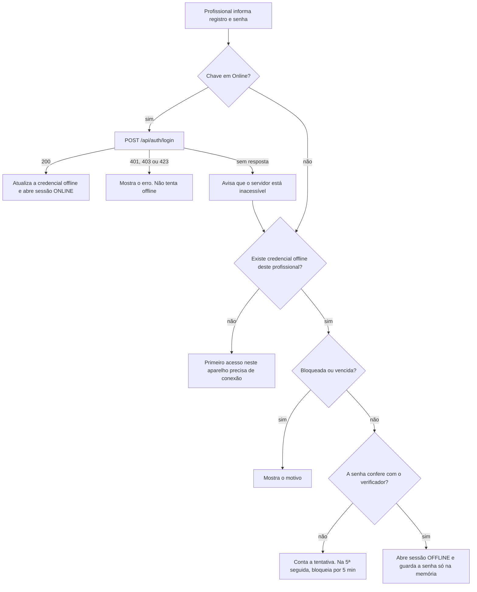

# 8. Segurança e auditoria

Autenticação (online e offline), sessão, autorização, proteção de rede e os logs de auditoria exigidos pelo enunciado.

---

## 8.1 Visão geral

| Camada | Como é protegida |
|---|---|
| Identidade | Login com tipo de registro (CRM, COREN ou ID de Socorrista) + registro + senha. Senha guardada em bcrypt |
| Requisições | Token de acesso JWT assinado (RS256) em **todas** as rotas, menos o login |
| Dispositivo | Login offline por verificador local (scrypt). Tokens guardados criptografados pelo cofre do Windows |
| Rede | Só o Nginx fica exposto. Banco e serviços ficam fechados dentro da VM |
| Banco | Um usuário por serviço, cada um só no próprio schema. Auditoria só aceita inserção |
| Auditoria | Log de toda requisição nos três serviços + log das ações feitas no aparelho |

---

## 8.2 Profissionais e perfis

- **Tipo de registro:** `CRM` (médico), `COREN` (enfermagem) ou `SOCORRISTA` (ID de socorrista). O login é feito com tipo + registro (maiúsculas e minúsculas não importam) + senha.
- **Perfil:** `OPERACIONAL` (usa o app cliente) ou `ADMIN` (pode entrar no portal, ex.: o médico regulador da central). Qualquer perfil usa o app cliente; o portal só aceita `ADMIN`.
- **Cadastro:** direto no banco, como o enunciado permite. A senha é gerada no próprio SQL com `crypt('senha', gen_salt('bf', 10))` (exemplo em [05-modelo-de-dados.md](05-modelo-de-dados.md#authprofissional)).

---

## 8.3 Tokens

### Token de acesso (JWT)

- Assinado pelo **ms-auth** com a **chave privada** RSA (algoritmo RS256). Vale **15 minutos**.
- Os outros serviços conferem com a **chave pública**: assinatura, emissor, público e validade. Só quem tem a chave privada (o ms-auth) consegue emitir token. Cada serviço valida sozinho, sem consultar o ms-auth.

| Campo (claim) | Conteúdo |
|---|---|
| `sub` | ID do profissional |
| `sid` | ID da sessão (`auth.sessao`) |
| `nome`, `tipoRegistro`, `registro`, `perfil` | Dados do profissional, para os serviços não precisarem consultar |
| `iss` | `medicalfield-auth` |
| `aud` | `medicalfield` |
| `iat`, `exp` | Emissão e validade |

### Refresh token

- 32 bytes aleatórios (texto base64url), sem significado. O servidor guarda **só o hash** (SHA-256).
- Vale até o fim da sessão: **7 dias depois do login**, sem prorrogação.
- **Não muda a cada renovação** (D-06). Se mudasse e a resposta da renovação se perdesse numa rede instável, o aparelho ficaria com um token já invalidado e perderia a sessão. Em troca, ele é guardado criptografado no aparelho e é revogado no logout.
- A cada renovação, o servidor confere: sessão não revogada, dentro da validade e profissional ativo.

### Onde ficam

| Onde | Token de acesso | Refresh token |
|---|---|---|
| App cliente | Só na memória | No SQLite, criptografado pelo cofre do Windows (`safeStorage` do Electron) |
| Portal | `sessionStorage` (some ao fechar a aba) | `sessionStorage` |

### Chaves

Geradas com [`infra/scripts/gerar-chaves-jwt.sh`](../infra/scripts/gerar-chaves-jwt.sh) e guardadas em `infra/secrets/` (fora do Git). A privada vai só para o ms-auth; a pública vai para os três. Gerar chaves novas invalida todos os tokens: todo mundo precisa entrar de novo.

---

## 8.4 Login online

1. Busca o profissional por tipo + registro.
2. Se está bloqueado, responde `423 CONTA_BLOQUEADA` (com `bloqueadoAte`).
3. Confere a senha (bcrypt). Se estiver errada, conta a tentativa e responde `401 CREDENCIAIS_INVALIDAS`. Na **5ª errada seguida, bloqueia por 5 minutos** e já responde `423 CONTA_BLOQUEADA`. Para um registro inexistente, a resposta é igual à da senha errada (e demora o mesmo tempo), para não revelar quem existe.
4. Se a senha confere: zera as tentativas. Se o profissional estiver inativo, responde `403 PROFISSIONAL_INATIVO`.
5. Cria a sessão e devolve os tokens e os dados do profissional.

---

## 8.5 Login offline

O professor pediu que o login funcione sem conexão. Funciona assim:

**Pré-requisito:** o profissional precisa ter entrado **online pelo menos uma vez naquele aparelho**. É nesse momento que o app aprende a reconhecer a senha dele. Antes disso, aparece "O primeiro acesso neste aparelho precisa de conexão".

**O que o app guarda a cada login online** (tabela `credencial_offline`): nome, perfil e um **verificador da senha**. O verificador é um hash scrypt com sal aleatório (scrypt N=2¹⁵, r=8, p=1, 32 bytes). Ele é lento de calcular de propósito: se alguém copiar o arquivo do banco, testar senhas no chute fica muito caro. A senha em si nunca é gravada.

**Validade:** a credencial offline vale **7 dias desde a última validação online**. Conta como validação um login online ou uma renovação de sessão bem-sucedida. Passado o prazo, o app pede um login online. Assim, um profissional desativado no servidor não usa o aparelho para sempre.

Regras complementares:

- **Login automático ao voltar a conexão.** Depois de um login offline, a senha fica **só na memória** do app (nunca em disco). Quando a conexão volta, o app faz o login online sozinho para conseguir os tokens e sincronizar. Se o app for fechado antes disso, ele pede a senha de novo na hora de sincronizar.
- **Vários profissionais por aparelho** (a equipe da ambulância): cada um tem a sua credencial offline. Trocar de usuário é sair e entrar com outro registro.
- **Senha trocada no servidor:** o aparelho aprende a nova no próximo login online. Até lá (no máximo 7 dias), a senha antiga ainda funciona offline. É uma limitação conhecida.
- **Profissional desativado:** quando o servidor responde `403 PROFISSIONAL_INATIVO` (no login ou na renovação), o app apaga a credencial offline dele.
- Todo login, online ou offline, bem-sucedido ou não, vira log local (`LOGIN_ONLINE`, `LOGIN_OFFLINE`, `LOGIN_FALHOU`).

---

## 8.6 Sessão mantida

- Fechar e abrir o app **mantém o profissional logado**. A sessão só acaba se ele clicar em **Sair**, se a sessão local vencer (fim da sessão do servidor ou da validade offline) ou se o servidor recusar a renovação.
- Ao abrir o app com a chave em Online, ele renova o token de acesso em silêncio. Com a chave em Offline, segue na sessão local.
- **Sair** apaga a sessão local e o refresh token e, se estiver online, avisa o servidor (`POST /api/auth/logout`). A credencial offline **continua**, então o profissional pode entrar offline depois. Se houver pendentes, o app avisa que eles continuam guardados e serão enviados por quem entrar em seguida.
- Sair estando offline: a sessão no servidor vence sozinha. Ninguém mais consegue usá-la, porque o aparelho já apagou o refresh token.

**No Portal Admin:**

- A sessão fica no `sessionStorage`: recarregar a página mantém o login; fechar a aba encerra.
- O portal renova o token de acesso sozinho, quando faltam 30 segundos para vencer ou quando o servidor responde `401`. Várias requisições ao mesmo tempo esperam uma renovação só.
- Se a renovação for recusada (sessão vencida ou encerrada), o portal volta ao login com o aviso "Sua sessão terminou" e esquece os dados que tinha carregado.
- **Sair** chama `POST /api/auth/logout` (o refresh token deixa de valer) e apaga a sessão do navegador.
- Um profissional operacional que tenta entrar no portal recebe "Acesso restrito a administradores", e a sessão que o servidor acabou de criar é encerrada na hora.

---

## 8.7 Autorização

- **Toda rota exige token, exceto `POST /api/auth/login`** (D-19). Não existem rotas abertas "de infraestrutura": o Docker confere se os serviços estão de pé testando a porta (não uma rota HTTP), e a documentação OpenAPI também exige token.
- **Rotas (admin):** `GET /api/profissional`, `GET /api/log/acesso`, `GET /api/log/cliente`, `GET /api/conflito` e `GET /api/documentos/email`. Com perfil operacional a resposta é `403 PROIBIDO`.
- **Portal:** só entra quem tem perfil `ADMIN`. O portal confere o perfil depois do login, e o servidor confere de novo nas rotas de admin.
- **App cliente:** aceita qualquer perfil.

---

## 8.8 Rede e segredos

- **Portas públicas na VM:** só a do Nginx (80) e a do SSH (22), que é para administração.
- **Banco:** publicado só em `127.0.0.1:5433`. É acessado pela própria VM ou por um túnel SSH ([12-implantacao.md](12-implantacao.md)). Os serviços não publicam porta nenhuma: só o Nginx fala com eles, pela rede interna do Docker.
- **Sem CORS:** o portal e a API estão no mesmo endereço; o app cliente faz as requisições pelo processo principal do Electron (que não é um navegador); o Postman não usa CORS.
- **HTTP sem criptografia**, por enquanto: a VM não tem domínio. HTTPS é opcional ([D-24](03-decisoes.md), [12-implantacao.md](12-implantacao.md)).
- **Segredos:** senhas do banco e do e-mail ficam em `infra/.env`; as chaves JWT, em `infra/secrets/`. Os dois ficam fora do Git (`.gitignore`). O modelo está em `infra/.env.example`.
- **Firewall recomendado na VM (ufw):** liberar 22 e 80 (e 443, se houver HTTPS). As portas do banco e dos serviços já estão presas a `127.0.0.1` ou à rede interna do Docker.

---

## 8.9 Log de acesso (servidor)

O enunciado exige um middleware/interceptor em **todos os serviços backend** que registre, em cada requisição HTTP: **data/hora, IP do cliente, ID do profissional autenticado, método HTTP, rota, status code e tempo de processamento (ms)**.

| Serviço | Como é feito |
|---|---|
| ms-auth (TypeScript, Fastify) | Ganchos `onRequest` (marca o início) e `onResponse` (grava) |
| ms-clinico (Java, Spring Boot) | Filtro de servlet (`OncePerRequestFilter`) em volta de toda a cadeia, incluindo a segurança |
| ms-docs (Python, FastAPI) | Middleware ASGI em volta de todo o app (inclusive da autenticação e do tratamento de erros), que grava numa thread separada |

Funcionamento (igual nos três):

1. Marca a hora de início.
2. Deixa a requisição seguir normalmente.
3. No fim, junta: status da resposta, tempo gasto, ID do profissional (do token já validado; vazio se não havia token válido; no login bem-sucedido, o ID de quem entrou), IP (do cabeçalho `X-Real-IP`, preenchido pelo Nginx), método, rota, `X-Dispositivo-Id` e user-agent.
4. Grava em `auditoria.log_acesso` **sem atrasar a resposta**. Se a gravação do log falhar, o erro vai para o log técnico do container e a requisição não é afetada.

**Tudo é registrado**, inclusive `401`, `403`, `404` e erros internos. Só ficam de fora as requisições que o Nginx recusa sem chegar a nenhum serviço (rota inexistente ou serviço fora do ar); essas ficam no log técnico do Nginx.

**Imutável:** um gatilho no banco recusa `UPDATE` e `DELETE` nas tabelas de auditoria, e ms-clinico e ms-docs só têm permissão de `INSERT`.

**Consulta:** página **Logs de acesso** do portal (com filtros por serviço, profissional, rota, status e período) ou SQL direto.

---

## 8.10 Log do cliente

O app registra localmente (`log_local`) as ações feitas no aparelho, principalmente as feitas offline, que o servidor não teria como saber. Elas sobem em lote pelo `POST /api/log` no fim de cada sincronização e vão para `auditoria.log_cliente`.

| Ação | Quando |
|---|---|
| `LOGIN_ONLINE` / `LOGIN_OFFLINE` | Login bem-sucedido |
| `LOGIN_FALHOU` | Senha errada, bloqueio ou credencial vencida |
| `LOGOUT` | Saída |
| `CONECTIVIDADE_ALTERADA` | A chave Online/Offline mudou de posição |
| `PESSOA_CRIADA`, `PRONTUARIO_CRIADO`, `ATENDIMENTO_CRIADO` | Cadastros |
| `EMAIL_SOLICITADO`, `PDF_BAIXADO` | Ficha de atendimento |
| `SINCRONIZACAO_INICIADA`, `SINCRONIZACAO_CONCLUIDA`, `SINCRONIZACAO_FALHOU` | Ciclos de sincronização |
| `REGISTRO_UNIFICADO` | O servidor unificou um registro deste aparelho |
| `ITEM_COM_ERRO` | Um item da fila falhou de vez |

Cada log tem: ID próprio, profissional, dispositivo, data/hora (do aparelho), modo (`ONLINE`/`OFFLINE`) e detalhes (ex.: o ID do atendimento). O app mostra esses logs na tela **Logs locais**, e o portal na página **Logs dos clientes**.

---

## 8.11 LGPD: o que fazemos e o que fica de fora

Dado de saúde é **dado pessoal sensível** pela LGPD. O que o projeto faz:

- só profissionais autenticados acessam dados clínicos, e cada acesso fica registrado;
- logs não podem ser alterados nem apagados;
- senhas nunca são guardadas em texto (bcrypt no servidor, scrypt no aparelho);
- tokens ficam criptografados no aparelho;
- o banco não fica exposto na internet, e cada serviço só enxerga o próprio schema;
- registros clínicos não são apagados nem reescritos.

O que fica fora do escopo, de propósito (o foco é a arquitetura, D-20):

| Ponto | Num sistema real |
|---|---|
| HTTPS | Obrigatório. Aqui depende de a VM ter domínio (D-24) |
| Criptografia do arquivo SQLite | Usaríamos SQLCipher, com a chave guardada no cofre do sistema |
| Minimização de dados no aparelho | O aparelho receberia só os pacientes da sua região ou equipe. Aqui recebe todos (D-26) |
| Consentimento, termos e política de retenção | Necessários para operar de verdade |
