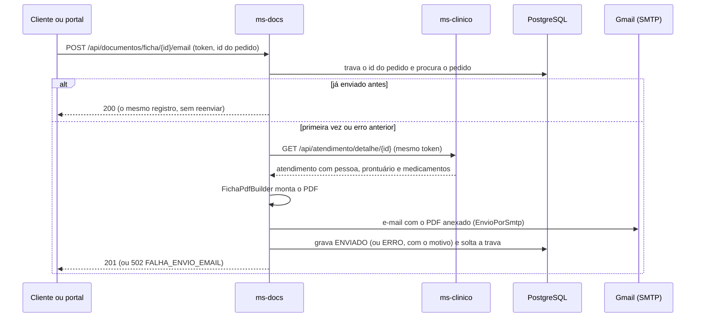

# ms-docs — Documentos e e-mail

**Linguagem:** Python 3.13 (FastAPI) · **Situação:** implementado (etapa 4)

## Responsabilidades

- Gerar o PDF da Ficha de Atendimento (padrão **Builder**), buscando os dados no ms-clinico com o token de quem pediu.
- Enviar a ficha por e-mail, em anexo, ao paciente, a um familiar ou a outro endereço (padrão **Adapter** sobre o SMTP do Gmail), com idempotência pelo ID do pedido: um ID nunca manda dois e-mails.
- Histórico de envios (rota de admin).
- Middleware de log de acesso (grava em `auditoria.log_acesso`, só com INSERT).

Rotas: [docs/06-api.md, seção 6.10](../../docs/06-api.md#610-ms-docs). Conteúdo do PDF e do e-mail: [docs/09-ficha-e-dominio.md](../../docs/09-ficha-e-dominio.md#95-o-pdf-da-ficha). Tabela: [`documentos.envio_email`](../../docs/05-modelo-de-dados.md#documentosenvio_email). Decisões deste serviço: D-35 a D-38 em [docs/03-decisoes.md](../../docs/03-decisoes.md). Configuração do Gmail: [docs/12-implantacao.md](../../docs/12-implantacao.md#128-e-mail-gmail).

## Como funciona um pedido



## Estrutura

```
ms_docs/
  __main__.py      ponto de entrada (python -m ms_docs): config, banco, migrations e Uvicorn
  principal.py     monta o app FastAPI a partir das dependências (as de verdade ou as dos testes)
  config.py        variáveis de ambiente
  banco.py         conexão (SQLAlchemy) e migrations (Alembic)
  seguranca.py     confere o JWT RS256 com a chave pública; dependências de autenticação e de admin
  auditoria.py     middleware de log de acesso + gravação em outra thread
  erros.py         formato padrão de erro e mensagens de validação em português
  clinico.py       cliente HTTP do ms-clinico
  ficha/           PDF: formatos.py (rótulos, datas, CPF), construtor.py (FichaPdfBuilder e MontadorDaFicha)
                   e modelos/ (ficha.html com uma macro por seção, ficha.css)
  correio/         e-mail: envio.py (interface EnvioDeEmail, mensagem, EnvioDesativado) e smtp.py (EnvioPorSmtp)
  envios/          pedido de e-mail: modelos (entrada e saída), servico.py (idempotência), repositorio.py, mensagem.py
  rotas/           documentos.py (as três rotas) e docs.py (especificação OpenAPI autenticada)
migracoes/         Alembic (versions/0001_envio_email.py)
testes/            pytest (ver docs/13-testes-automatizados.md)
```

## Variáveis de ambiente

| Variável | Padrão | Para quê |
|---|---|---|
| `PORTA` | `8000` | Porta HTTP |
| `DB_HOST`, `DB_PORTA`, `DB_NOME`, `DB_USUARIO` | `localhost`, `5432`, `medicalfield`, `ms_docs` | Banco |
| `DB_SENHA` | — (obrigatória) | Senha do usuário `ms_docs` |
| `JWT_CHAVE_PUBLICA_ARQUIVO` | `/run/secrets/jwt-publica.pem` | Chave que confere os tokens do ms-auth |
| `MS_CLINICO_URL` | `http://ms-clinico:8080` | De onde vêm os dados da ficha |
| `SMTP_HOST` | — | Servidor de e-mail. **Sem ele, o envio fica desligado** (a rota responde `502`, D-38) |
| `SMTP_PORTA` | `587` | |
| `SMTP_SEGURANCA` | `SSL` na porta 465; `STARTTLS` nas outras | `STARTTLS`, `SSL` ou `NENHUMA` (só para servidor de teste local) |
| `SMTP_USUARIO`, `SMTP_SENHA` | — | Conta e senha de app do Gmail (os espaços da senha de app são ignorados) |
| `SMTP_REMETENTE` | o `SMTP_USUARIO` | `conta@gmail.com` ou `Nome <conta@gmail.com>`. Sem nome, aparece "MedicalField" |
| `FUSO_HORARIO` | `America/Sao_Paulo` | Horário das datas no PDF e no e-mail (o banco guarda tudo em UTC) |

No Docker Compose tudo isso vem do `infra/.env` e de `infra/secrets/`.

## Rodando e testando no desenvolvimento

Pré-requisitos: Python 3.13 e as bibliotecas de sistema do WeasyPrint (no Ubuntu/Debian: `libpango-1.0-0 libpangoft2-1.0-0 libharfbuzz-subset0`, mais alguma fonte, como `fonts-dejavu-core`). Com o banco do `infra/` no ar (`docker compose up -d db ms-auth`):

```bash
python3 -m venv .venv
.venv/bin/pip install -r requirements-dev.txt
DB_HOST=127.0.0.1 DB_PORTA=5433 DB_SENHA=<MS_DOCS_DB_PASSWORD> MS_AUTH_DB_SENHA=<MS_AUTH_DB_PASSWORD> .venv/bin/pytest
.venv/bin/ruff check . && .venv/bin/ruff format --check .
```

- Os testes não precisam do ms-auth nem do ms-clinico no ar: geram as próprias chaves JWT, usam um ms-clinico falso e um servidor SMTP de teste local. O que cada teste cobre está em [docs/13-testes-automatizados.md](../../docs/13-testes-automatizados.md).
- Sem Python na máquina: `docker build --target testes -t ms-docs-testes .` roda os mesmos testes na imagem da produção (comando completo no doc 13).
- Rodar o serviço direto do código: `.venv/bin/python -m ms_docs`, com as variáveis acima e `JWT_CHAVE_PUBLICA_ARQUIVO=../../infra/secrets/jwt-publica.pem`. Para testar e-mail sem Gmail: `.venv/bin/python -m aiosmtpd -n -l 127.0.0.1:1025` num terminal (mostra as mensagens recebidas) e `SMTP_HOST=127.0.0.1 SMTP_PORTA=1025 SMTP_SEGURANCA=NENHUMA SMTP_REMETENTE=teste@exemplo.com`.

## Dependências e migrations

- As dependências diretas ficam no `pyproject.toml`. As versões exatas, inclusive as indiretas, ficam em `requirements.txt` (produção) e `requirements-dev.txt` (testes). Para atualizar: `uv pip compile pyproject.toml -o requirements.txt` e `uv pip compile pyproject.toml --extra dev -o requirements-dev.txt` (ou o `pip-compile`, do pip-tools).
- As migrations rodam sozinhas quando o serviço sobe. Para criar uma nova: `.venv/bin/alembic revision -m "o que muda"` (com as variáveis `DB_*` definidas), e escrever o SQL em `migracoes/versions/`.
